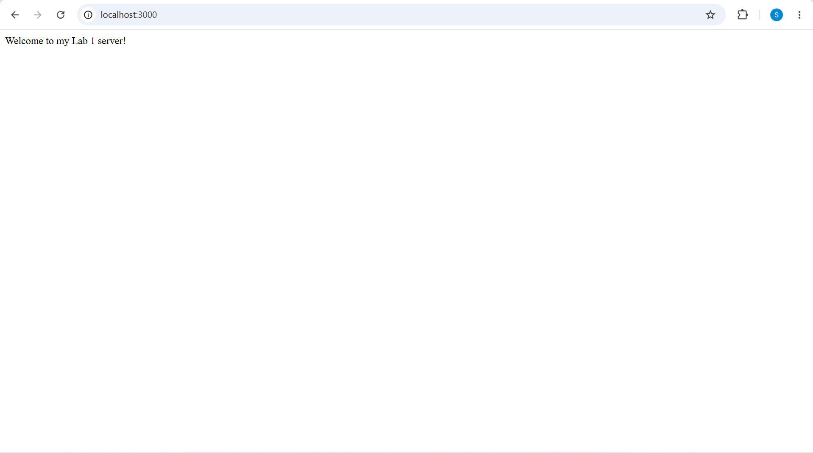
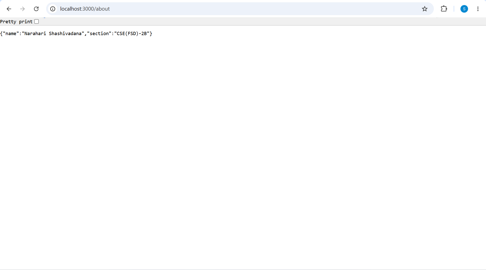
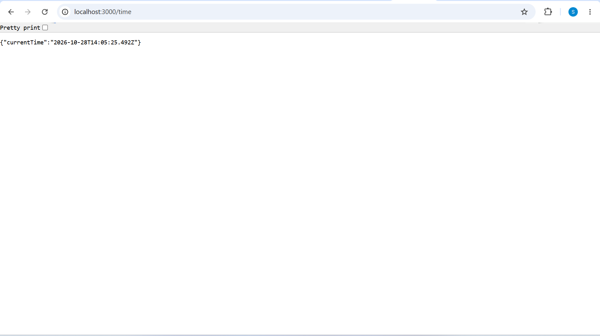
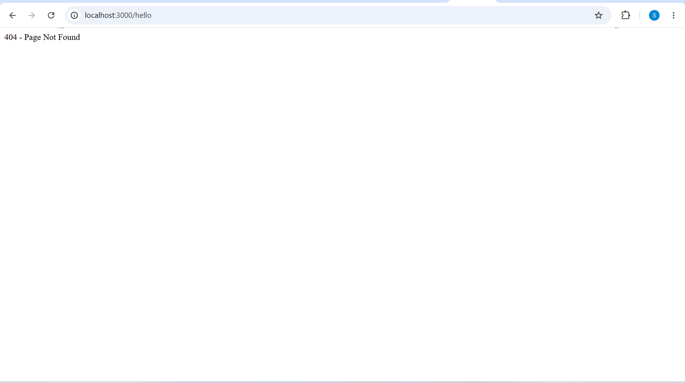

Lab 1: Node.js and Express Server
Student Details
Name: Narahari Shashivadana
Section: CSE(FSD)-2B 309
Course: Backend Development Fundamentals
Lab Number: 01
Live Link
**Deployment URL: 
Objective
To set up a Node.js.project, create a basic HTTP server using the built-in http module, and build an Express server with multiple routes and appropriate HTTP status codes.
Technologies Used
Node.js
Express.js
Javascript
npm
Visual Studio Code
Project Structure

